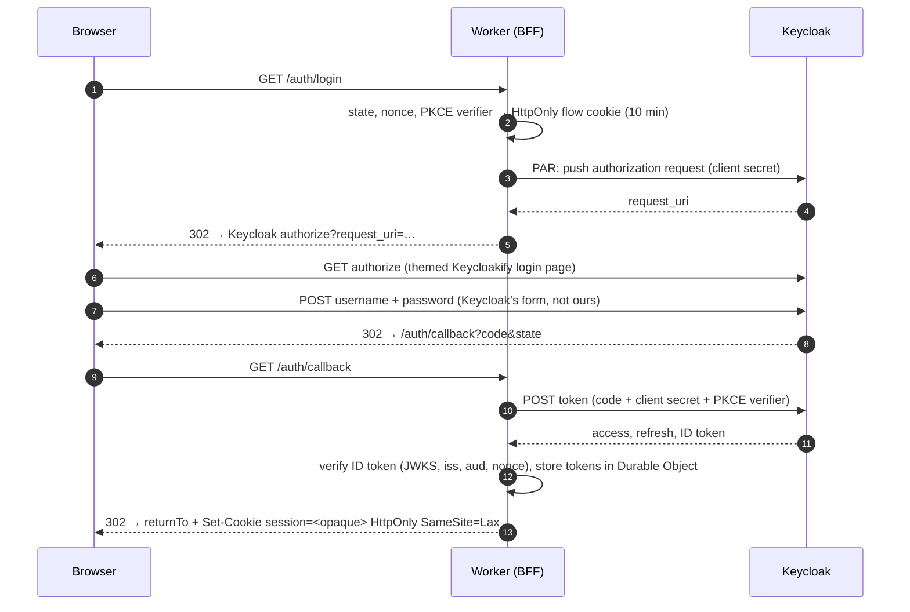
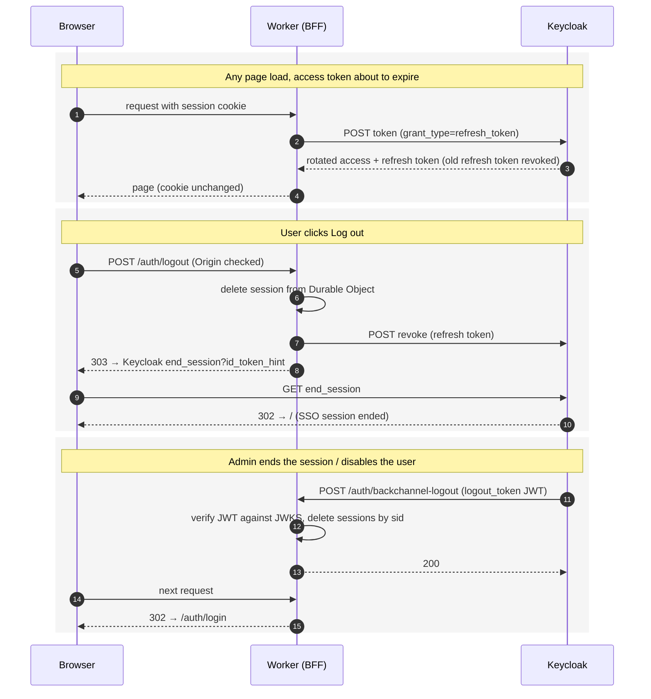

# Next Console × Keycloak — BFF proof of concept

TanStack Start on Cloudflare Workers, authenticating against Keycloak with a
**backend-for-frontend**: Keycloak hosts the login page (themed to the Next
Console design), the Worker holds every token in a Durable Object, and the
browser only ever gets an opaque `HttpOnly` cookie.

```
app/             TanStack Start + Cloudflare Workers (the BFF)
keycloak-theme/  Keycloakify login theme matching the Figma "Next Console, Login" frame
keycloak/        docker-compose + realm import for a local Keycloak 26
```

## Run it

Prerequisites: Node 22+, pnpm 10, Docker Desktop, Java 17+ (Keycloakify's
bundler needs a JDK; Maven is not required).

```bash
pnpm install
pnpm build:theme          # builds the Keycloakify JAR and copies it to keycloak/providers/
pnpm keycloak:up          # Keycloak 26 on http://localhost:8080 (admin / admin), realm "next" imported
cp app/.dev.vars.example app/.dev.vars
pnpm dev                  # app on http://localhost:3000
```

Sign in with the seeded user `demo` / `demo`.

Other scripts: `pnpm theme:dev` (login page with a mocked Keycloak context, no
Keycloak needed), `pnpm theme:storybook`, `pnpm keycloak:logs`, `pnpm keycloak:down`.

## How the flow works

1. `GET /auth/login` — Worker generates `state`, `nonce` and a PKCE verifier, stores
   them in a 10-minute `HttpOnly` cookie, pushes the authorization request to
   Keycloak (**PAR**, so no auth parameters travel through the browser URL) and
   redirects to Keycloak's login page.
2. Keycloak renders the **Keycloakify theme** (`keycloak-theme/`). The form posts
   to Keycloak, never to the app: brute-force detection, MFA, required actions and
   password policy stay Keycloak's job.
3. `GET /auth/callback` — Worker exchanges the code with the **confidential client
   secret** + PKCE verifier, verifies the ID token (signature via JWKS, `iss`,
   `aud`, `nonce`, `exp`), stores access/refresh/ID tokens in the `SessionStore`
   Durable Object and sets an opaque 256-bit session cookie. Only the SHA-256 of
   that cookie is stored, so a dumped table cannot forge sessions.
4. Server functions call `resolveSession()`, which lives in the Durable Object and
   **refreshes tokens transparently** (deduplicated per session, because Keycloak
   rotates refresh tokens and parallel refreshes would invalidate each other).
   `beforeLoad` guards are UX only; enforcement is in the server code.
5. `POST /auth/logout` — same-origin check, delete the session, revoke the refresh
   token, redirect to Keycloak's end-session endpoint so SSO ends too.
6. `POST /auth/backchannel-logout` — Keycloak calls this with a signed
   `logout_token` when an admin ends a session or disables a user. Verified with
   `jose` against Keycloak's JWKS; matching sessions are deleted immediately.

### Sequence: sign-in



### Sequence: session lifecycle



Keycloak client hardening in `keycloak/import/next-realm.json`: confidential
client, authorization code only (no direct access grants, no implicit), PKCE
S256 required, PAR required, refresh-token rotation (`revokeRefreshToken`,
`refreshTokenMaxReuse: 0`), 5-minute access tokens, exact redirect URIs,
back-channel logout with session, brute-force protection, realm roles mapped
into the ID token.

## Theme

`keycloak-theme/src/login/pages/Login.tsx` and `Template.tsx` are the only two
components that were replaced; markup and CSS are ours, the form contract
(`url.loginAction`, `username`, `password`, `rememberMe`, `credentialId`) is
Keycloak's. Tokens from the Figma file live in `src/login/main.css`. Every other
page (reset password, OTP, errors…) still uses Keycloakify's default look until
it is ejected the same way: `npx keycloakify eject-page` inside `keycloak-theme/`.

### Languages

The realm enables `en`, `fr` and `ar`; the JAR ships Keycloak's bundles for all
30 locales, so adding a language is a realm setting. The console passes its
current language with `/auth/login?ui_locales=fr`, and the page also has a
switcher (links come from Keycloak, so switching keeps the login session).
Arabic flips the page to RTL automatically; the CSS uses logical properties so
it mirrors correctly. Wording overrides live in `src/login/i18n.ts` and must be
given in every supported language: a key defined in only one language becomes
the fallback for all the others.

After changing the theme: `pnpm build:theme` then `pnpm keycloak:up` (it
rebuilds the Keycloak image with the new JAR baked in; realm data is kept
only if the container is not recreated, so expect a fresh realm). The JAR is
copied into the image rather than bind-mounted on purpose: Keycloak memory-maps
provider JARs and a macOS bind mount makes it fail with "Failed to load
themes" in the admin console.

## Production notes (not done in this PoC)

- Serve the app over https so the cookies get the `__Host-` prefix and `Secure`
  flag (automatic when `APP_URL` is https).
- Put the client secret in `wrangler secret put KEYCLOAK_CLIENT_SECRET`;
  consider `private_key_jwt` client auth instead of a shared secret.
- Keycloak must be reachable from Cloudflare's edge (Cloudflare Tunnel + Access
  service token if it is private). Set `KEYCLOAK_ISSUER` to the public https URL
  and remove the `allowInsecureRequests` dev branch.
- Apply Keycloak's built-in `oauth-2-1-for-confidential-client` client profile
  as a client policy so the hardening is enforced realm-wide, not per client.
- Single Durable Object for all sessions is simple and gives instant revocation;
  shard by user id if it ever becomes a hotspot.
- Terms of Use / Privacy Policy links in the theme are placeholders.

## QA checklist

**Login**
- Home → "Sign in with Keycloak" → Keycloak page shows the Next Console design (logo lockup, card, grey button, grid background).
- Wrong password → red field borders + "Invalid username or password." inside the card.
- `demo` / `demo` → lands on `/dashboard` with name, email, role `console-admin`.
- Browser devtools → Application → Cookies: one `session` cookie, `HttpOnly`, `SameSite=Lax`; `document.cookie` is empty; no tokens in local/session storage.
- Open `/dashboard` directly while logged out → redirected to Keycloak, back to `/dashboard` after login.

**Session lifetime**
- Wait >5 min on the dashboard, reload → still signed in, "expires in" counter reset (silent refresh).
- Admin console → Users → demo → Sessions → Sign out, then reload the dashboard → redirected to login (back-channel logout). App log prints `Back-channel logout: removed 1 session(s)`.
- Admin console → Users → demo → disable user → reload after the access token expires → redirected to login (refresh refused).

**Logout**
- Dashboard → "Log out" → back on home with "Sign in with Keycloak"; opening `/dashboard` asks for credentials again (Keycloak SSO session ended, not just the app cookie).
- `curl -X POST http://localhost:3000/auth/logout` without an `Origin` header → 403.

**Languages**
- `/auth/login?ui_locales=fr` → French page, `?ui_locales=ar` → Arabic page mirrored right-to-left, switcher top corner shows the three languages with the current one highlighted.
- Switch language on the page, then log in → still lands on `/dashboard` (the switch keeps the auth session).

**Theme tooling**
- `pnpm theme:dev` → login page renders with mocked context at http://localhost:5173.
- `pnpm theme:storybook` → `login/login.ftl` stories "Default" and "WithInvalidCredentials".
- Edit `main.css`, `pnpm build:theme`, reload Keycloak login → change visible without restarting.
